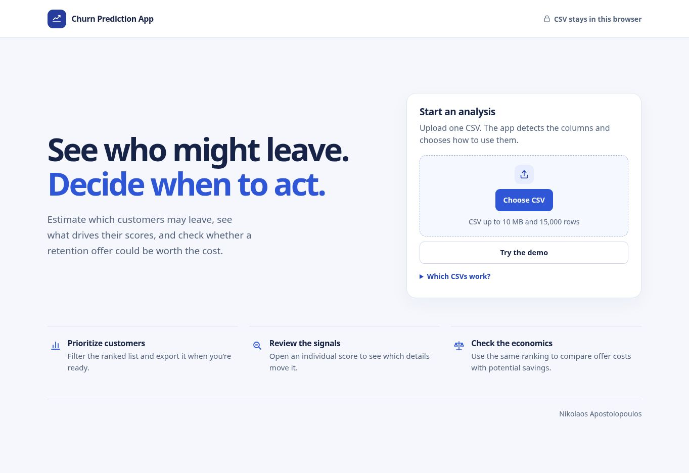

# Customer Churn Prediction Tool

A web app for exploring customer churn: who is most likely to leave, which inputs influence that prediction, and whether a retention offer could be worth its cost.

The app compares logistic regression with XGBoost, explains individual predictions with SHAP, and calculates retention scenarios. It runs in Streamlit and uses the IBM Telco Customer Churn dataset, also available on Kaggle.

**[Open the live app](https://customer-churn-tool-gupuvojt3rwndamjdgahnv.streamlit.app/)** · [Reading the dashboard](docs/READING_THE_DASHBOARD.md) · [Methodology](docs/METHODOLOGY.md)

## Dashboard preview




## Project contribution

A risk score is only part of a retention decision. Someone using the app also needs to understand the prediction and weigh the cost of acting on it.

This project connects those steps in one interface. Users can compare models, inspect individual customers, and change campaign assumptions without running a notebook or writing code. The contribution is the integration of evaluation, explanations, and business calculations into a usable application. It uses established methods rather than introducing a new machine learning algorithm.

## Using the app

The opening screen introduces the project and its prediction → explanation → retention workflow. Choose **Sample data** and click **Use sample data**, or select **Upload CSV**. Once loaded, **Change customer data** lets you switch inputs. Use **Explore the dashboard** to move between four sections:

| Section | What it shows | Question it answers |
|---|---|---|
| Customers | Outcome counts, missing values, churn within groups | What does the historical data contain? |
| Models | Precision/recall bars, precision–recall curves, a confusion-matrix heatmap | How useful are the predictions, and where are the mistakes? |
| Individual risk | Score distribution, a churn-capture curve, a ranked list, individual SHAP bars | Who receives high scores, and which inputs influence them? |
| Retention plan | Cost/benefit bars and savings across campaign sizes | What could contacting these customers cost or save? |

Charts include labeled axes, short explanations, and tap/hover details. On narrow screens, charts and controls stack vertically, summary cards use two columns, and navigation uses a full-width section selector. Customer group counts are also available in an expandable table. Campaign inputs and the selected customer are preserved when switching sections. Detailed interpretation, worked examples, and caveats are in [Reading the dashboard](docs/READING_THE_DASHBOARD.md).

The app downloads the sample automatically. If the download fails, it uses clearly labeled fictional data so the interface remains usable.

Rankings cover held-out test customers, whose outcomes were not used for training or model selection. This version evaluates historical customers; it does not yet score a separate file of future customers without known outcomes.

## How it works

Customers are split into 60% training, 20% validation, and 20% testing, using a fixed random seed. Each group retains approximately the original churn proportion.

Numeric fields are checked for invalid values, and text fields are standardized. Missing-value replacements, numerical scaling, and category encoding are fitted on training customers only. Customer IDs and the churn outcome are excluded from model inputs.

Logistic regression provides a simple baseline. XGBoost captures more complex relationships through an ensemble of decision trees. Validation average precision selects the model; test data is reserved for the final comparison. Both models use a fixed 0.50 classification threshold.

SHAP explanations work with either selected model. The chart groups contributions into the original customer fields, such as contract type and tenure. Positive contributions increase the model score; negative contributions decrease it. These contributions use log-odds, the model's internal score scale, rather than percentage-point changes in probability.

See [Methodology](docs/METHODOLOGY.md) for the implementation details and [Mathematical modelling](docs/MATHEMATICAL_MODELLING.md) for the equations behind preprocessing, both models, evaluation, SHAP, and retention scenarios.

## Results

The [model improvement study](docs/MODEL_IMPROVEMENT.md) records the nested validation experiments, full results, and limitations behind the updated XGBoost settings.


Measured on the 7,043-row IBM Telco sample with the supplied code:

| Model | Validation AP | Test precision | Test recall | Test AP | Test Brier |
|---|---:|---:|---:|---:|---:|
| Logistic regression | 0.6423 | 0.6509 | 0.5535 | 0.6338 | 0.1378 |
| XGBoost | 0.6480 | 0.6643 | 0.5027 | 0.6674 | 0.1345 |

XGBoost was selected by validation average precision, although the difference was small. Logistic regression had higher recall at the fixed threshold. The results show a tradeoff rather than a clear advantage on every measure.

- **Precision:** among customers flagged as leaving, the fraction who actually left.
- **Recall:** among customers who left, the fraction flagged by the model.
- **Average precision (AP):** summarizes ranking quality across thresholds; higher is better and should be interpreted against the churn rate.
- **Brier score:** average squared probability error; lower is better.

The app also shows a confusion matrix with the counts of correct and incorrect stay/leave predictions. Results differ for uploaded data and the fictional fallback.

## Run locally

Use Python 3.12. From the project folder on Windows:

```bat
py -3.12 -m venv .venv
.venv\Scripts\activate.bat
python -m pip install -r requirements.txt
python -m streamlit run app.py
```

On macOS/Linux, replace the first two commands with:

```bash
python3.12 -m venv .venv
source .venv/bin/activate
```

Open http://localhost:8501. No API keys are required.

To run the automated checks:

```bash
python -m pytest -q
```

The project was checked on Python 3.12.14 on Linux, with 21 tests passing. Checks cover input validation, offline loading, data splits, training-only preprocessing, both SHAP explainers, business calculations, uploads, caching, chart serialization, group summaries, and agreement between the savings curve and calculator.

## Repository structure

| Path | Responsibility |
|---|---|
| `app.py` | Streamlit interface, charts, caching, and error messages |
| `src/data.py` | Data loading, format cleaning, validation, and offline sample |
| `src/model.py` | Preprocessing, splitting, training, evaluation, and ranking |
| `src/explain.py` | Individual SHAP explanations |
| `src/business.py` | Retention scenario calculations |
| `src/charts.py` | Interactive charts and visual summaries |
| `src/layout.py`, `src/styles.css` | Responsive layout, section navigation, and touch-friendly controls |
| `tests/test_basic.py` | Automated checks |
| `docs/MATHEMATICAL_MODELLING.md` | Equations, derivations, and worked examples |
| `docs/METHODOLOGY.md` | Data requirements and implementation details |
| `docs/READING_THE_DASHBOARD.md` | Chart interpretation, examples, and caveats |
| `.streamlit/config.toml` | Consistent light theme and upload limit |
| `requirements.txt` | Pinned application dependencies |

## Limitations

Churn models find patterns, not proven causes. An input that influences a prediction is not necessarily something a business can change to prevent churn. SHAP explains the model's behavior, so a suggested action may not fix the problem.

The savings calculation depends on an assumed offer success rate and model risk estimates. Neither probability calibration nor campaign impact has been established. A randomized retention experiment would be needed to measure the effect of an offer.

The sample is an older demonstration dataset. A random split does not establish performance on future customers, and fairness across customer groups has not been assessed. Use with another business would require a defined prediction horizon, time-based evaluation where possible, and checks on probability quality and sensitive features.

Uploads require supported Telco-style columns and known historical churn outcomes. Use public or fictional data for this portfolio app: uploaded data is processed on the server and temporarily cached in memory. The app does not provide production access controls.

## Data sources

- [IBM Telco Customer Churn repository](https://github.com/IBM/telco-customer-churn-on-icp4d)
- [Telco Customer Churn on Kaggle](https://www.kaggle.com/datasets/blastchar/telco-customer-churn)

**Author:** Nikolaos Apostolopoulos


## Interface

The main views focus on customer outcomes, model comparison, individual explanations, and retention scenarios. Supporting charts and technical details are expandable. The retention view includes the success assumption needed to break even. Detailed chart interpretation is in [Reading the dashboard](docs/READING_THE_DASHBOARD.md).
