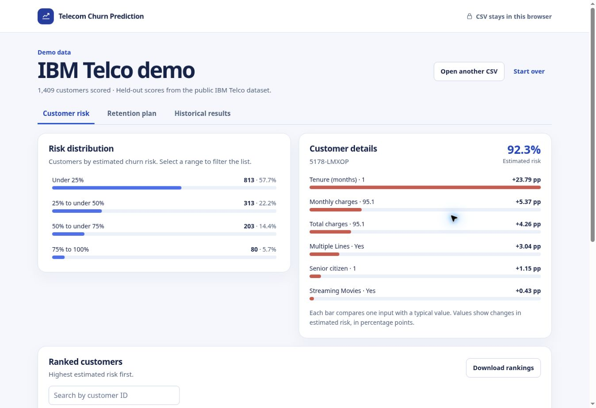
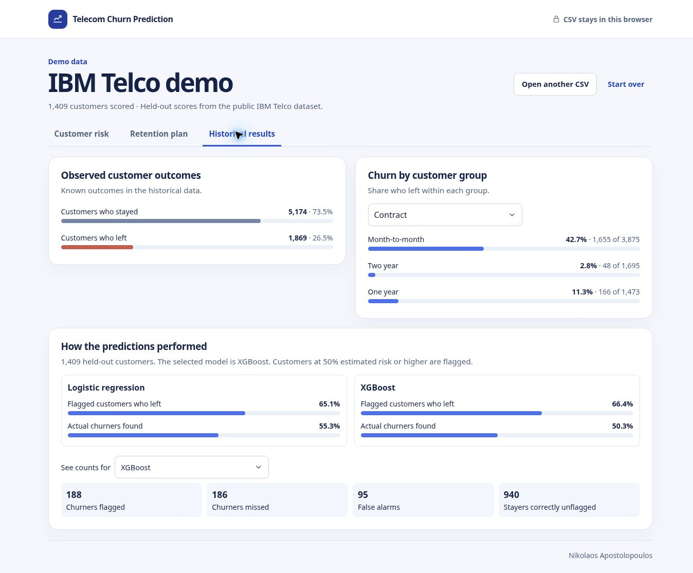
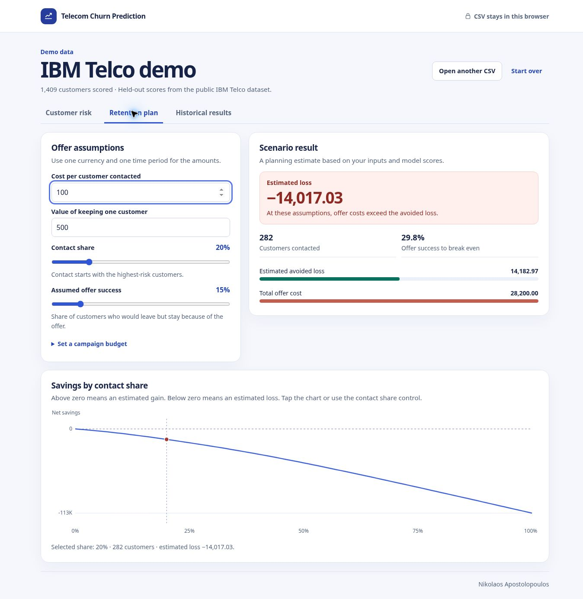

# Telecom Churn Prediction

[Open the live app](https://nikosapostolo.github.io/customer-churn-tool/) · [Run it locally](#run-locally)

Identify customers at risk of leaving and test whether a retention offer could be worth the cost. The dashboard brings telecom customer risk, individual explanations, and the cost of acting on the same ranking into one workflow. Try the IBM Telco demo or upload a single CSV. The browser processes the file locally.



<details>
<summary>More screenshots of the current app</summary>

**Start an analysis**


**Historical results**



**Retention plan**



</details>

## What you can do

| View | What it shows |
| --- | --- |
| **Customer risk** | See the distribution of estimated risk, filter or search the ranking, and download it as a CSV. Open a customer to see how the score changes when one input at a time is compared with a typical value. |
| **Historical results** | Review observed churn, compare groups, and see how the models performed on held-out customers. This view appears when historical outcomes are available. |
| **Retention plan** | Adjust the contact share, offer cost, customer value, assumed success rate, and optional budget. See the estimated gain or loss, the success rate needed to break even, and the zero-contact baseline. |

## Using your own CSV

- **With known churn outcomes.** Upload a file with customer details and a column that records who left and who stayed. Include at least 100 rows, with at least 20 customers in each outcome group. The browser compares logistic regression and boosted trees, then displays the selected model's scores for held-out customers.
- **With new customers to score.** Upload a file with the complete IBM Telco or Churn Prediction 2020 inputs to use a built-in model. If you have already trained on your own historical data in this session, **Open another CSV** can score a file with matching inputs.
- **File format.** Use a UTF-8 CSV with headers, up to 10 MB and 15,000 rows. Supported separators are commas, semicolons, tabs, and pipes. Supply unique customer IDs if you want the exported rankings to use your own identifiers.

Use the risk estimate to prioritize review. Individual score explanations describe the model's response to a change in an input. Retention results depend on your assumed offer success and the model's risk estimates. Measuring the actual effect of an offer requires campaign data.

## Run locally

From the repository root:

```bash
python -m http.server 8000 --bind 127.0.0.1 --directory web/dist
```

Open [http://127.0.0.1:8000](http://127.0.0.1:8000). The browser app is in [`web/dist/`](web/dist/), including the demo data and model assets. The original Python/Streamlit implementation is in [`app.py`](app.py) and [`src/`](src/). Its [methodology](docs/METHODOLOGY.md) and [model experiments](docs/MODEL_IMPROVEMENT.md) document the earlier implementation.

Demo data source: [IBM Telco Customer Churn](https://github.com/IBM/telco-customer-churn-on-icp4d).

**Author:** Nikolaos Apostolopoulos
